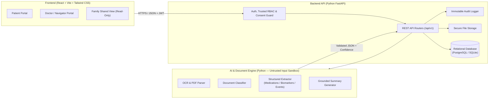

# BridgeCare — Technical Specification

> **Event:** BioForge 2026 Hackathon  
> **Document Status:** Revised Final Specification (Documentation Phase)  
> **Repository Status:** Planning & Documentation — **No application source code, database migrations, or AI pipelines are implemented yet.** All modules, schemas, endpoints, and workflows described in this document represent **planned functionality**.

---

## 1. Executive Summary & Current Implementation Status

**BridgeCare** is an AI-assisted Personal Health Record (PHR) organizer designed to transform scattered lab reports, prescriptions, and clinical notes into structured health timelines, unit-safe biomarker trends, medication tracking, holistic health logs, and doctor-ready briefs.

### Implemented vs. Planned Functionality

| Category | Current Status | Details |
| :--- | :--- | :--- |
| Repository & Git Setup | **Implemented** | Base repository initialized with `README.md`, `LICENSE`, `.gitignore`, and branch structure (`main`, `develop`, `feature/backend`, `feature/frontend`, `feature/ai-engine`, `docs/documentation`). |
| Technical Specification | **Implemented** | Documented in `docs/technical-specification.md`. |
| Frontend Application (React + Vite + Tailwind) | **Planned** | Not yet implemented. |
| Backend API (Python FastAPI) | **Planned** | Not yet implemented. |
| Database Schema & Persistence | **Planned** | Not yet implemented. |
| AI/OCR Processing Pipeline | **Planned** | Not yet implemented. |
| Patient & Doctor/Navigator Portals | **Planned** | Not yet implemented. |
| All Nine Product Modules & Security Foundation | **Planned** | Not yet implemented. |

> **Clinical & Coverage Disclaimers:**  
> - BridgeCare is a health-record organization and summarization tool. It does not provide medical diagnoses, treatment recommendations, or clinical decision-making.  
> - All AI-extracted data requires human verification before being treated as a confirmed record.  
> - Automated medication flags (such as potential duplicate active-ingredient warnings) are informational only and require professional clinical review; BridgeCare never recommends starting, stopping, or changing any medication.  
> - Insurance records stored in BridgeCare are user-provided/extracted summaries and never constitute confirmed coverage without direct insurer verification.

---

## 2. Frozen Product Scope: Nine Modules & MVP-First Implementation Priorities

BridgeCare's product scope consists of **nine frozen product modules**, supported by a **Cross-Cutting Security, Privacy & Governance Foundation** (Section 7). To ensure realistic delivery during BioForge 2026, development follows an **MVP-first** priority plan:

- **Priority P0 (Core MVP):** Essential document intelligence, unified personal health record, grounded clinical summaries, and the cross-cutting security foundation.
- **Priority P1 (Core Clinical & Family Extensions):** Longitudinal biomarker analytics, smart medication management, family health management, and the Doctor/Navigator portal.
- **Priority P2 (Extended Care & Support):** Holistic health management, patient assistance & emergency support, and insurance & healthcare information.

| # | Product Module | Priority | Status | Planned Functionality |
| :---: | :--- | :---: | :---: | :--- |
| **1** | **AI Medical Document Intelligence** | **P0 (Core MVP)** | Planned | Secure ingestion, OCR text extraction, document classification (`lab_report`, `prescription`, `discharge_summary`, `clinical_note`, `other`), schema-constrained structured extraction, confidence scoring, prompt-injection defense, and mandatory human-in-the-loop (HITL) verification. |
| **2** | **Unified Personal Health Record** | **P0 (Core MVP)** | Planned | Centralized patient document vault and chronological clinical timeline uniting verified events, linked source documents, and provenance metadata. |
| **3** | **AI Clinical Intelligence** | **P0 (Core MVP)** | Planned | Generation of doctor-ready briefs and clinical summaries grounded strictly in verified records, with source citations and explicit labelling of uncertain or missing information. |
| **4** | **Longitudinal Health Analytics** | **P1 (Extension)** | Planned | Biomarker extraction and longitudinal trend comparisons that preserve original units, compare only compatible values, and display lab-specific reference ranges. |
| **5** | **Smart Medication Management** | **P1 (Extension)** | Planned | Structured extraction of brand name, generic ingredients, strength, dosage, frequency, duration, and instructions when recorded; medication history, adherence reminders, and potential duplicate active-ingredient warnings requiring professional review. |
| **6** | **Holistic Health Management** | **P2 (Extension)** | Planned | Unified tracking of holistic health records spanning **Allopathy**, **Ayurveda/AYUSH**, and **preventive wellness** records (lifestyle, screenings, vaccinations, wellness logs) alongside conventional clinical data. |
| **7** | **Family Health Management** | **P1 (Extension)** | Planned | Separate family member profiles with isolated health records, explicit opt-in consent-based sharing, granular permission scopes, optional expiration, and immediate revocation. |
| **8** | **Patient Assistance & Emergency Support** | **P2 (Extension)** | Planned | Local-language text/voice assistance for navigating records, appointment/medication reminders, emergency contact directory, and nearby hospital discovery. |
| **9** | **Insurance & Healthcare Information** | **P2 (Extension)** | Planned | Storage and organization of insurance provider details, policy metadata, validity dates, coverage notes, **Ayushman Bharat** card information, and user-entered hospitalisation expenses (with explicit non-confirmation disclaimers). |

---

## 3. System Architecture

BridgeCare follows a decoupled three-layer architecture: a **React + Vite + Tailwind CSS** single-page frontend, a **Python FastAPI** backend API, and a modular **AI/OCR Processing Engine** orchestrated by the backend. Security, RBAC, consent enforcement, and audit logging operate as a cross-cutting foundation across all layers.

### 3.1 Frontend Architecture (Planned)
- **Stack:** React, Vite, Tailwind CSS.
- **Structure:** Role-aware routing separating the **Patient Portal**, **Doctor/Navigator Portal**, and **Family Shared View**, plus modular views for Holistic Health, Patient Assistance/Emergency, and Insurance/Expenses.
- **Key UX Principles:**
  - Side-by-side document viewer and extracted-field verification form.
  - Visual badges distinguishing `Verified`, `Pending Review`, and `Uncertain / Missing` data.
  - Clear clinical and insurance disclaimers on automated flags and policy views.
  - No third-party AI API keys or privileged credentials stored in client-side code.

### 3.2 Backend Architecture (Planned)
- **Stack:** Python 3.11+, FastAPI, Pydantic v2, SQLAlchemy (with Alembic migrations for PostgreSQL or SQLite for rapid hackathon prototyping).
- **Responsibilities:**
  - Request validation, JWT authentication, trusted role assignment, and per-request enforcement of patient ownership, navigator assignment, and active consent.
  - Secure file ingestion (MIME/magic-byte validation, size caps, randomized storage keys).
  - Asynchronous or background job orchestration for OCR and LLM extraction.
  - Strict separation between raw AI output (`pending_review`) and patient-verified records (`verified`).

---

## 4. Portals & Role-Based Access Control (RBAC)

BridgeCare enforces least-privilege access across three primary roles. **User roles are assigned strictly through trusted backend logic** (public self-registration defaults to `patient`; `doctor_navigator` accounts require verified onboarding or administrative approval, and unrestricted role assignment from public registration payloads is never accepted).

| Role | Access Scope | Allowed Actions (Planned) |
| :--- | :--- | :--- |
| **`patient`** | Own records & managed family profiles | Upload/delete own documents; review, edit, verify, or reject AI extractions; view own timeline, medications, biomarkers, holistic records, and insurance/expenses; manage reminders and emergency contacts; generate doctor-ready briefs; grant/revoke family & navigator access; view own audit log. |
| **`doctor_navigator`** | Explicitly assigned & consented patients only | View verified clinical summaries, timelines, medications, biomarker trends, holistic records, and linked source documents only when **both** an active navigator assignment and active patient consent exist; add clinical/navigator notes (stored separately from patient-verified extractions). Cannot modify patient verification status or sharing settings. |
| **`family_member`** | Explicitly consented patient/profile & granted scopes only | Read-only access strictly filtered by granular permission scopes (`view_documents`, `view_medications`, `view_biomarkers`, `view_holistic_records`, `view_summaries`, `view_insurance`, `view_hospitalisation_expenses`). Access terminates immediately upon revocation or expiry. |

---

## 5. Database Entities & Proposed API Routes

### 5.1 Planned Database Entities

1. **`users`**
   - `id` (UUID, PK), `email` (unique), `password_hash`, `full_name`, `role` (`patient` | `doctor_navigator` | `family_member`), `preferred_language`, `is_active`, `created_at`, `updated_at`.
2. **`family_profiles`**
   - `id` (UUID, PK), `owner_user_id` (FK -> `users.id`), `linked_user_id` (FK -> `users.id`, nullable), `full_name`, `relationship`, `date_of_birth` (nullable), `created_at`. *(Ensures each family member has isolated records rather than mixing clinical data across profiles.)*
3. **`documents`**
   - `id` (UUID, PK), `patient_id` (FK -> `users.id`), `profile_id` (FK -> `family_profiles.id`, nullable), `uploaded_by` (FK -> `users.id`), `original_filename`, `mime_type`, `file_size_bytes`, `storage_key` (randomized internal path), `sha256_hash`, `document_type` (`lab_report` | `prescription` | `discharge_summary` | `clinical_note` | `ayush_record` | `insurance_doc` | `other`), `processing_status` (`uploaded` | `processing` | `extracted` | `failed`), `ocr_text`, `document_date`, `uploaded_at`.
4. **`ai_extractions`**
   - `id` (UUID, PK), `document_id` (FK -> `documents.id`), `model_identifier`, `raw_payload_json`, `confidence_score`, `verification_status` (`pending_review` | `verified` | `edited_verified` | `rejected`), `verified_by` (FK -> `users.id`, nullable), `verified_at` (nullable), `created_at`.
5. **`clinical_events`**
   - `id` (UUID, PK), `patient_id` (FK -> `users.id`), `profile_id` (FK -> `family_profiles.id`, nullable), `document_id` (FK -> `documents.id`), `event_type`, `event_date`, `title`, `description`, `uncertainty_flags` (JSON array), `is_verified` (boolean), `created_at`.
6. **`medications`**
   - `id` (UUID, PK), `patient_id` (FK -> `users.id`), `profile_id` (FK -> `family_profiles.id`, nullable), `document_id` (FK -> `documents.id`), `brand_name` (nullable), `generic_ingredients` (nullable), `strength` (nullable), `dosage` (nullable), `frequency` (nullable), `duration` (nullable), `instructions` (nullable), `status` (`active` | `completed` | `discontinued`), `start_date` (nullable), `end_date` (nullable), `source_excerpt`, `is_verified` (boolean), `created_at`.
7. **`biomarker_results`**
   - `id` (UUID, PK), `patient_id` (FK -> `users.id`), `profile_id` (FK -> `family_profiles.id`, nullable), `document_id` (FK -> `documents.id`), `analyte_name`, `standardized_name` (nullable), `value_numeric` (nullable), `value_text`, `original_unit`, `ref_range_low` (nullable), `ref_range_high` (nullable), `ref_range_text` (nullable), `lab_name` (nullable), `specimen_date`, `abnormal_flag` (nullable), `is_verified` (boolean).
8. **`holistic_records`**
   - `id` (UUID, PK), `patient_id` (FK -> `users.id`), `profile_id` (FK -> `family_profiles.id`, nullable), `document_id` (FK -> `documents.id`, nullable), `care_system` (`allopathy` | `ayurveda_ayush` | `preventive_wellness`), `record_type`, `title`, `details`, `practitioner_name` (nullable), `record_date`, `is_verified` (boolean), `created_at`.
9. **`clinical_summaries`**
   - `id` (UUID, PK), `patient_id` (FK -> `users.id`), `profile_id` (FK -> `family_profiles.id`, nullable), `summary_type` (`timeline_overview` | `doctor_brief`), `content_json`, `grounded_document_ids` (JSON array), `uncertainty_notes` (JSON array), `generated_at`.
10. **`family_consents`**
    - `id` (UUID, PK), `patient_id` (FK -> `users.id`), `profile_id` (FK -> `family_profiles.id`, nullable), `recipient_user_id` (FK -> `users.id`, nullable until accepted), `recipient_email`, `permissions_json` (granular boolean/enum scopes: `view_documents`, `view_medications`, `view_biomarkers`, `view_holistic_records`, `view_summaries`, `view_insurance`, `view_hospitalisation_expenses`), `status` (`active` | `revoked` | `expired`), `granted_at`, `expires_at` (nullable), `revoked_at` (nullable).
11. **`navigator_assignments` & `navigator_notes`**
    - `navigator_assignments`: `id` (UUID, PK), `patient_id` (FK -> `users.id`), `navigator_id` (FK -> `users.id`), `assignment_status` (`active` | `inactive`), `consent_status` (`pending` | `active` | `revoked` | `expired`), `assigned_at`, `granted_at` (nullable), `expires_at` (nullable), `revoked_at` (nullable). *(Access requires both `assignment_status = 'active'` and `consent_status = 'active'` with non-expired `expires_at`.)*
    - `navigator_notes`: `id` (UUID, PK), `patient_id` (FK -> `users.id`), `author_id` (FK -> `users.id`), `note_text`, `created_at`.
12. **`reminders` & `emergency_contacts`**
    - `reminders`: `id` (UUID, PK), `patient_id` (FK -> `users.id`), `medication_id` (FK -> `medications.id`, nullable), `reminder_type` (`medication` | `appointment` | `wellness`), `title`, `schedule_cron_or_time`, `language_code`, `is_active`, `created_at`.
    - `emergency_contacts`: `id` (UUID, PK), `patient_id` (FK -> `users.id`), `name`, `relationship`, `phone_number`, `is_primary`, `created_at`.
13. **`insurance_records` & `hospitalisation_expenses`**
    - `insurance_records`: `id` (UUID, PK), `patient_id` (FK -> `users.id`), `provider_name`, `policy_number_encrypted` (encrypted at rest), `plan_name`, `valid_from`, `valid_to`, `coverage_summary`, `ayushman_bharat_id_encrypted` (nullable, encrypted at rest), `is_insurer_verified` (boolean, default `false`), `created_at`.
    - `hospitalisation_expenses`: `id` (UUID, PK), `patient_id` (FK -> `users.id`), `insurance_record_id` (FK -> `insurance_records.id`, nullable), `hospital_name`, `admission_date`, `discharge_date` (nullable), `amount_claimed_or_spent`, `currency`, `notes`, `entered_by` (FK -> `users.id`), `created_at`.
14. **`audit_logs`**
    - `id` (UUID, PK), `actor_id` (FK -> `users.id`), `actor_role`, `action`, `resource_type`, `resource_id`, `patient_id`, `metadata_json` (operational metadata only; excludes clinical text, diagnoses, medications, biomarkers, and policy/ABHA identifiers), `created_at`. *(Append-only; protected against modification or deletion.)*

#### Family Profile Isolation & Ownership Integrity Rules
- Any record in `documents`, `clinical_events`, `medications`, `biomarker_results`, `holistic_records`, or `clinical_summaries` that references a `profile_id` **must** pass a server-side ownership check confirming `family_profiles.owner_user_id == record.patient_id`.
- Cross-profile references (e.g., attaching a `profile_id` owned by another user or querying without matching both `patient_id` and `profile_id`) are rejected with `403 Forbidden` to prevent IDOR and cross-profile data leakage.

### 5.2 Proposed API Routes (`/api/v1`)

All routes below are **proposed** and enforce JWT authentication, ownership/navigator assignment, and active consent checks on every protected request (except `/auth/register` and `/auth/login`):

- **Authentication & Identity**
  - `POST /api/v1/auth/register` — Create a `patient` account (role fixed server-side; privileged roles require verified onboarding).
  - `POST /api/v1/auth/login` — Issue access and refresh tokens.
  - `POST /api/v1/auth/refresh` — Rotate refresh token and issue new access token.
  - `GET /api/v1/auth/me` — Return current authenticated user profile and role.
- **Document Vault (Module 1 & 2)**
  - `POST /api/v1/documents/upload` — Upload PDF/image; validate MIME/magic bytes and store securely.
  - `GET /api/v1/documents` — List documents accessible to the caller.
  - `GET /api/v1/documents/{document_id}` — Get document metadata and processing status.
  - `GET /api/v1/documents/{document_id}/file` — Stream original file after RBAC/consent verification.
  - `DELETE /api/v1/documents/{document_id}` — Patient-only deletion of own document.
- **AI Processing & Human Verification (Module 1)**
  - `POST /api/v1/documents/{document_id}/process` — Trigger OCR, classification, and structured extraction.
  - `GET /api/v1/documents/{document_id}/extraction` — Retrieve extracted fields, confidence scores, and source excerpts.
  - `PATCH /api/v1/extractions/{extraction_id}/verify` — Submit human-verified edits and mark records `verified` or `rejected`.
- **Timeline & Grounded Clinical Intelligence (Module 2 & 3)**
  - `GET /api/v1/patients/{patient_id}/timeline` — Return chronological verified clinical events.
  - `POST /api/v1/patients/{patient_id}/summaries/generate` — Generate a doctor-ready brief from verified records.
  - `GET /api/v1/patients/{patient_id}/summaries` — List generated summaries with source citations.
- **Longitudinal Health Analytics (Module 4)**
  - `GET /api/v1/patients/{patient_id}/biomarkers` — List biomarker results with original units and lab ranges.
  - `GET /api/v1/patients/{patient_id}/biomarkers/compare` — Compare compatible longitudinal values for a selected analyte.
- **Smart Medication Management (Module 5)**
  - `GET /api/v1/patients/{patient_id}/medications` — List current and historical medications (with verification status).
  - `PATCH /api/v1/medications/{medication_id}` — Update or verify medication fields.
  - `GET /api/v1/patients/{patient_id}/medications/warnings` — Check for potential duplicate active ingredients across active medications (informational warning requiring professional review).
- **Holistic Health Management (Module 6)**
  - `POST /api/v1/patients/{patient_id}/holistic-records` — Create an Allopathy, Ayurveda/AYUSH, or preventive wellness record.
  - `GET /api/v1/patients/{patient_id}/holistic-records` — List holistic records filtered by care system.
- **Family Health Management & Consent (Module 7)**
  - `POST /api/v1/family/profiles` — Create an isolated family member profile owned by the authenticated patient.
  - `GET /api/v1/family/profiles` — List managed or shared family profiles (strictly scoped by ownership/consent).
  - `POST /api/v1/sharing/consents` — Create a granular sharing grant using standardized scopes (`view_documents`, `view_medications`, `view_biomarkers`, `view_holistic_records`, `view_summaries`, `view_insurance`, `view_hospitalisation_expenses`).
  - `GET /api/v1/sharing/consents` — List active, expired, and revoked consents.
  - `PATCH /api/v1/sharing/consents/{consent_id}` — Update granular permission scopes.
  - `POST /api/v1/sharing/consents/{consent_id}/revoke` — Immediately revoke family access.
- **Patient Assistance & Emergency Support (Module 8)**
  - `POST /api/v1/patients/{patient_id}/reminders` & `GET /api/v1/patients/{patient_id}/reminders` — Manage medication/appointment reminders.
  - `POST /api/v1/patients/{patient_id}/emergency-contacts` & `GET /api/v1/patients/{patient_id}/emergency-contacts` — Manage emergency contacts.
  - `POST /api/v1/assistance/query` — Local-language text/voice query grounded in the patient's verified records.
  - `GET /api/v1/assistance/nearby-hospitals` — Discover nearby hospitals based on user-supplied location/pincode.
- **Insurance & Healthcare Information (Module 9)**
  - `POST /api/v1/patients/{patient_id}/insurance` & `GET /api/v1/patients/{patient_id}/insurance` — Manage policy details, validity, coverage notes, and Ayushman Bharat card information.
  - `POST /api/v1/patients/{patient_id}/expenses` & `GET /api/v1/patients/{patient_id}/expenses` — Record and list user-entered hospitalisation expenses.
- **Doctor / Navigator Portal & Navigator Consent**
  - `POST /api/v1/navigator/consents` — Patient grants explicit consent (with optional `expires_at`) for an assigned `doctor_navigator`.
  - `GET /api/v1/navigator/consents` — List active, pending, expired, and revoked navigator consents.
  - `POST /api/v1/navigator/consents/{assignment_id}/revoke` — Patient immediately revokes navigator consent (`consent_status = 'revoked'`).
  - `GET /api/v1/navigator/patients` — List patients where **both** `assignment_status = 'active'` and `consent_status = 'active'` (not expired/revoked).
  - `GET /api/v1/navigator/patients/{patient_id}/brief` — Retrieve verified brief and linked citations (enforcing active assignment + active consent).
  - `POST /api/v1/navigator/patients/{patient_id}/notes` — Append a navigator note (enforcing active assignment + active consent).
- **Audit Logs (Cross-Cutting Security)**
  - `GET /api/v1/audit-logs` — Retrieve patient-scoped audit history (read-only).

---

## 6. AI Pipeline, Clinical Safety & Domain Rules

### 6.1 Document Processing, Prompt-Injection Defense & Human Verification
1. **Ingestion:** File is validated (allowlisted MIME types + magic bytes), hashed (`SHA-256`), and stored outside the web root.
2. **Untrusted Input & Prompt-Injection Defense:** Uploaded files and extracted OCR text are treated strictly as **untrusted data**, never as instructions. The AI pipeline isolates system prompts from document text using explicit delimiters, disables arbitrary tool/code execution during extraction, enforces strict Pydantic/JSON schema validation on model outputs, and sanitizes extracted text before rendering in the UI.
3. **OCR & Classification:** Native PDF text is extracted where available; scanned PDFs and images pass through OCR. Documents are classified (`lab_report`, `prescription`, `discharge_summary`, `clinical_note`, `ayush_record`, `insurance_doc`, `other`).
4. **Structured Extraction & HITL Verification:** Extraction outputs JSON with field-level confidence indicators and source text excerpts. All AI outputs enter `pending_review` and require human verification before becoming `verified`.

### 6.2 Grounded Clinical Summaries & Uncertainty Labelling
- **Strict Grounding:** Summaries and doctor-ready briefs are generated **exclusively from verified records** (`is_verified = true`). Every claim links back to its supporting `document_id` or `clinical_event_id`.
- **Explicit Uncertainty & Gap Labelling:** Incomplete, illegible, or conflicting records are surfaced with explicit labels:
  - `[Uncertain: low OCR confidence / illegible text]`
  - `[Missing: duration not recorded in prescription]`
  - `[Unverified records excluded: N documents pending review]`
- The system never fabricates missing dates, dosages, or diagnoses.

### 6.3 Smart Medication Management Rules
- **Recorded Fields Only:** Extracts `brand_name`, `generic_ingredients`, `strength`, `dosage`, `frequency`, `duration`, and `instructions` **only when recorded** in the source document (missing fields remain `null` / `Not recorded`).
- **History & Reminders:** Tracks active, completed, and discontinued medications and supports patient-configured reminders.
- **Duplicate Active-Ingredient Warnings:** Compares `generic_ingredients` across active medications to flag potential duplicate active ingredients. Every warning is strictly informational, states that **professional clinical/pharmacist review is required**, and **never recommends starting, stopping, or changing any medication**.

### 6.4 Unit-Safe Biomarker Comparison
- **Preserve Original Units:** Stores `value_numeric`/`value_text`, `original_unit`, `lab_name`, and **lab-specific reference ranges** (`ref_range_low`, `ref_range_high`, `ref_range_text`) exactly as reported.
- **Compatible Comparisons Only:** Longitudinal comparisons only group values with compatible analyte identity, specimen type, and compatible units. Incompatible units or differing lab reference ranges are rendered as separate series or annotated individually rather than silently coerced.

### 6.5 Holistic, Assistance & Insurance Domain Rules
- **Holistic Health:** Supports structured logging across **Allopathy**, **Ayurveda/AYUSH**, and **preventive wellness** so patients and clinicians have full context without conflating care systems.
- **Patient Assistance & Emergency Support:** Provides local-language text/voice interaction grounded in verified records, reminders, emergency contact quick-access, and nearby hospital discovery.
- **Insurance & Expenses:** Stores provider, policy details, validity, coverage notes, **Ayushman Bharat** card details, and user-entered hospitalisation expenses. Every insurance view displays a clear notice that **coverage is not confirmed without direct insurer verification**.

---

## 7. Cross-Cutting Security, Privacy & Governance Foundation

Security and privacy are **not** a separate feature module; they form a cross-cutting foundation enforcing protection across all nine product modules:

- **Authentication:** Passwords hashed with `Argon2id` or `bcrypt`. Short-lived JWT access tokens paired with refresh token rotation.
- **Trusted Role Assignment & Per-Request Authorization:** Roles are assigned only by trusted backend logic (never accepted unrestricted from public registration). Every protected API endpoint enforces patient ownership, **both** active navigator assignment and active patient consent, or active granular family consent on every request (preventing IDOR).
- **Family Profile Isolation:** Every create, read, update, and share operation on `documents`, `clinical_events`, `medications`, `biomarker_results`, `holistic_records`, and `clinical_summaries` validates that any supplied `profile_id` belongs to the owning `patient_id`, preventing cross-profile access.
- **Consent Enforcement & Immediate Revocation:** Both family sharing and doctor/navigator access require explicit patient opt-in consent. Revocation sets `status = 'revoked'` (or `consent_status = 'revoked'`) and `revoked_at = now()`, taking effect immediately on the next request.
- **Encryption at Rest & Sensitive Identifier Protection:** Uploaded medical files are encrypted at rest (e.g., AES-256-GCM / envelope encryption) in isolated storage outside the web root. Sensitive identifiers—specifically `insurance_records.policy_number_encrypted` and `insurance_records.ayushman_bharat_id_encrypted`—are encrypted at rest and masked in standard list views.
- **Secure File Uploads:** Allowlisted MIME types (`application/pdf`, `image/png`, `image/jpeg`), magic-byte verification, file size limits, and randomized UUID storage keys.
- **API-Key Protection:** All LLM, OCR, and external service keys live exclusively in backend environment variables (`.env` excluded via `.gitignore`), never in frontend bundles or Git.
- **Tamper-Resistant & Minimal Audit Logging:** Every login, upload, download, verification, brief generation, consent grant, and revocation writes to `audit_logs`. Audit records are append-only and protected against unauthorized modification or deletion, and `metadata_json` stores only operational identifiers (never unnecessary medical text, diagnoses, medications, biomarkers, or insurance/ABHA identifiers).

---

## 8. Team Responsibilities & Git Workflow

### 8.1 Agreed Team Responsibilities

| Team Member | Role & Ownership |
| :--- | :--- |
| **Himanshu Kumar** | AI/ML and integration coordinator (OCR, document classification, structured extraction, prompt-injection defense, grounded summarization, end-to-end integration). |
| **Shreyash** | Backend (FastAPI architecture, database models, trusted RBAC/auth, per-request consent enforcement, secure file handling, immutable audit APIs). |
| **Ujjwal** | Frontend (React + Vite + Tailwind CSS portals, verification UI, timeline, biomarker charts, medication/holistic/insurance/assistance views, sharing controls). |
| **Shubha** | Biomedical review, documentation and presentation (clinical accuracy review of medication/biomarker/holistic schemas, safety disclaimers, hackathon documentation & pitch). |

### 8.2 Git Branch Structure

All active development follows the agreed branch naming convention:

- `feature/backend` — Python FastAPI backend, database models, auth, and API routes.
- `feature/frontend` — React + Vite + Tailwind CSS frontend portals and UI components.
- `feature/ai-engine` — OCR, document classification, structured extraction, and grounded summarization modules.
- `docs/documentation` — Technical specifications, architecture docs, and BioForge 2026 presentation materials.
